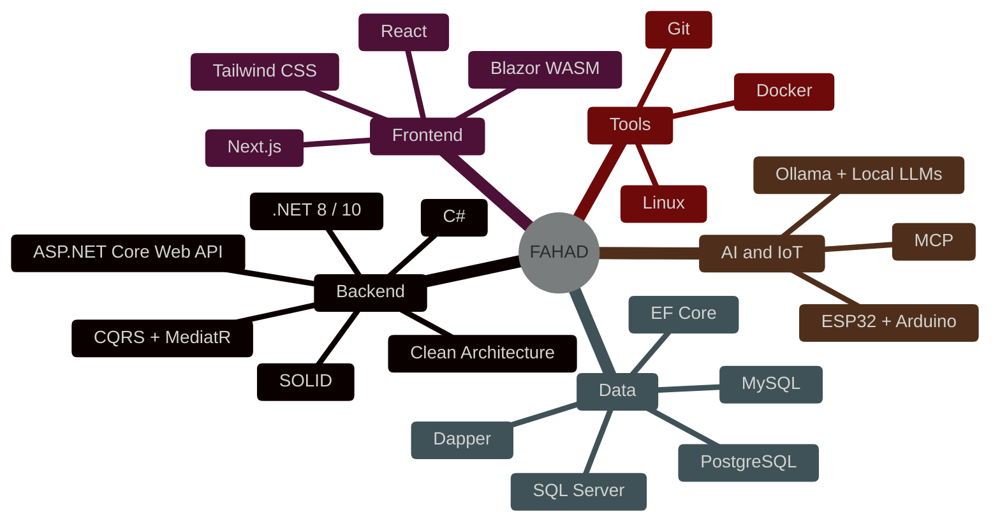
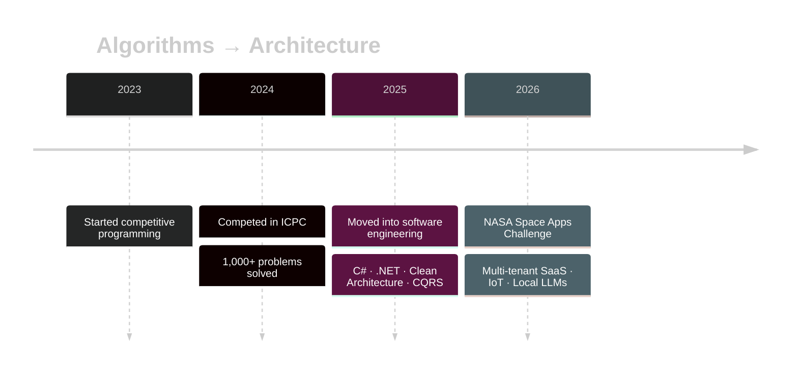
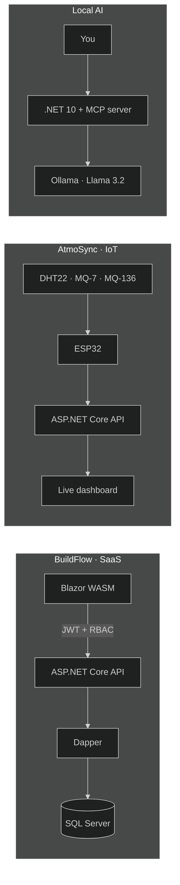

<div align="center">

```text
███████╗ █████╗ ██╗  ██╗ █████╗ ██████╗
██╔════╝██╔══██╗██║  ██║██╔══██╗██╔══██╗
█████╗  ███████║███████║███████║██║  ██║
██╔══╝  ██╔══██║██╔══██║██╔══██║██║  ██║
██║     ██║  ██║██║  ██║██║  ██║██████╔╝
╚═╝     ╚═╝  ╚═╝╚═╝  ╚═╝╚═╝  ╚═╝╚═════╝
      M D .   F A H A D   H A S A N
```

### Full-Stack .NET Developer &nbsp;◆&nbsp; System Architect &nbsp;◆&nbsp; Problem Solver

*From competitive algorithms to multi-tenant SaaS, IoT pipelines and AI integrations — I build resilient systems engineered for scale.*

**[LinkedIn](https://linkedin.com/in/fahad-hasan-2969a3282/)** &nbsp;◆&nbsp; **[Email](mailto:hasan.fahad67@outlook.com)** &nbsp;◆&nbsp; **[LeetCode](https://leetcode.com/u/FahadHasan8386/)** &nbsp;◆&nbsp; **[Codeforces](https://codeforces.com/profile/fahadhasan)**

</div>

---

## ▌ PLAYER CARD

```text
┌───────────────────────────────────────────────────────────┐
│ CLASS    Full-Stack .NET Architect                        │
│ GUILD    Algorithms · Architecture · IoT · AI             │
│ CREED    No single stack fits every problem               │
│ QUEST    Build resilient systems engineered for scale     │
├───────────────────────────────────────────────────────────┤
│ ALGORITHMS     ███████████████████░  19/20                │
│                1,000+ solved · ICPC 2024                  │
│ C# / .NET      ██████████████████░░  18/20                │
│                8 / 10 · ASP.NET Core                      │
│ ARCHITECTURE   █████████████████░░░  17/20                │
│                Clean · CQRS · SOLID                       │
│ DATABASES      ████████████████░░░░  16/20                │
│                SQL Server · PostgreSQL · MySQL            │
│ FRONTEND       ██████████████░░░░░░  14/20                │
│                Blazor · React · Next.js                   │
│ IOT / HARDWARE █████████████░░░░░░░  13/20                │
│                ESP32 · Arduino · sensors                  │
│ LOCAL AI       █████████████░░░░░░░  13/20                │
│                Ollama · MCP · Llama 3.2                   │
├───────────────────────────────────────────────────────────┤
│ STATUS   [ONLINE]  open to collaboration & opportunities  │
└───────────────────────────────────────────────────────────┘
```

<sub>Bars are a fun self-rating, not a formal score.</sub>

---

## ▌ SKILL TREE



---

## ▌ THE TIMELINE



---

## ▌ HOW MY SYSTEMS FLOW



---

## ▌ MISSION LOG

> Click a file to open the briefing.

<details>
<summary><b>MISSION 01 ▸ BuildFlow</b> — Multi-tenant project management SaaS</summary>

<br/>

`ASP.NET Core Web API` `Blazor WASM` `Dapper` `SQL Server` `JWT`

- Strict **tenant data isolation** with custom **role-based access control (RBAC)**
- JWT **refresh-token** authentication
- Workspaces, projects, task pipelines, comments and real-time notifications

</details>

<details>
<summary><b>MISSION 02 ▸ MarsWalk</b> — NASA Space Apps Challenge 2026</summary>

<br/>

`Python FastAPI` `React` `Vite` `NASA DEM datasets`

- Martian terrain route-planning and elevation analysis, built with a multidisciplinary team
- Pathfinding over NASA elevation data to visualize the **3 safest return routes** for a rover

</details>

<details>
<summary><b>MISSION 03 ▸ AtmoSync AgroAI</b> — IoT hardware-software pipeline</summary>

<br/>

`ASP.NET Core Web API` `Blazor` `ESP32` `DHT22` `MQ-7` `MQ-136`

- End-to-end telemetry bridge from gas/climate sensors to a live web dashboard
- Real-time sensor ingestion and monitoring for smart-agriculture insights

</details>

<details>
<summary><b>MISSION 04 ▸ Local LLM Chatbot & MCP File Organizer</b> — privacy-first AI</summary>

<br/>

`.NET 10` `Ollama (Llama 3.2)` `Model Context Protocol`

- Conversational assistant powered entirely by local LLMs
- .NET 10 MCP server for directory scanning, smart file categorization and metadata indexing

</details>

<details>
<summary><b>MISSION 05 ▸ Social Microblogging Platform</b> — CPS Academy</summary>

<br/>

`ASP.NET Core Web API` `React` `Next.js` `PostgreSQL`

- Decoupled REST APIs with a modern SSR/SPA frontend
- Relational data modeling in PostgreSQL

</details>

<details>
<summary><b>MISSION 06 ▸ High-Performance File Streamer & Legacy Data Migrator</b></summary>

<br/>

`C#` `FileStream` `Buffered I/O`

- Generates, splits (**5 GB into 100 MB chunks**) and migrates massive datasets
- Minimal memory footprint and **zero data corruption**

</details>

---

## ▌ OPEN CHANNEL

```text
fahad@dev:~$ ./connect.sh

  linkedin    linkedin.com/in/fahad-hasan-2969a3282
  email       hasan.fahad67@outlook.com
  leetcode    leetcode.com/u/FahadHasan8386
  codeforces  codeforces.com/profile/fahadhasan

  connection established. let's build something great together.
```

<div align="center"><sub>◆ &nbsp; thanks for visiting &nbsp; ◆</sub></div>
