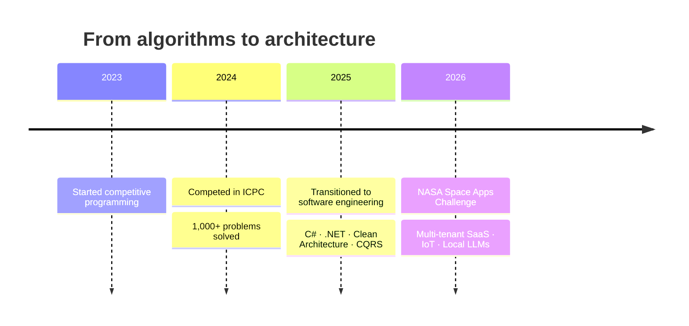

<div align="center">

# 👋 Hi, I'm Md. Fahad Hasan

### Full-Stack .NET Developer &nbsp;•&nbsp; System Architect &nbsp;•&nbsp; Problem Solver

*From competitive algorithms to multi-tenant SaaS, IoT pipelines and AI integrations — I build resilient systems engineered for scale.*

[**LinkedIn**](https://linkedin.com/in/fahad-hasan-2969a3282/) &nbsp;·&nbsp; [**Email**](mailto:hasan.fahad67@outlook.com) &nbsp;·&nbsp; [**LeetCode**](https://leetcode.com/u/FahadHasan8386/) &nbsp;·&nbsp; [**Codeforces**](https://codeforces.com/profile/fahadhasan)

</div>

---

## 🖥️ whoami

```text
╭──────────────────────────────────────────────────────────╮
│  name        Md. Fahad Hasan                             │
│  role        Full-Stack .NET Developer                   │
│  focus       Clean Architecture · CQRS · SOLID           │
│  builds      SaaS · IoT · AI · High-throughput data      │
│  philosophy  No single stack fits every problem          │
│  status      🟢 Open to opportunities & collaboration    │
╰──────────────────────────────────────────────────────────╯
```

## 📊 By the Numbers

| 🧩 **1,000+** | 🏆 **350+** | 🌍 **ICPC 2024** | 🚀 **2025** |
|:---:|:---:|:---:|:---:|
| problems solved | on Codeforces & LeetCode | competed | started professional .NET journey |

---

## 🧭 My Journey



- 🧠 **Algorithmic foundation** — sharp problem-solving, data structures, and performance thinking.
- ⚙️ **Architecture-first** — Clean Architecture, CQRS, SOLID, and high-throughput data access.
- 🧱 **Polyglot & pragmatic** — the right tool for the job: .NET, React/Next.js, Python, SQL, IoT hardware, Local LLMs.
- 📈 **Consistent shipper** — continuous building, open-source contributions, real-world business logic.

---

## 🛠️ Tech Arsenal

| Domain | Tools |
|:--|:--|
| ⚙️ **Backend & Architecture** | `C#` · `.NET 8/10` · `ASP.NET Core Web API` · `Clean Architecture` · `CQRS & MediatR` · `SOLID` |
| 🎨 **Frontend & Web** | `Blazor WASM` · `React` · `Next.js` · `Tailwind CSS` |
| 🗄️ **Databases & Data Access** | `SQL Server` · `PostgreSQL` · `MySQL` · `Dapper` · `EF Core` |
| 🤖 **AI · IoT · DevOps** | `Ollama & Local LLMs` · `ESP32 & Arduino` · `Docker` · `Git` · `Linux` |

---

## 🏗️ Featured Projects

<table>
<tr>
<td width="50%" valign="top">

### 🏢 BuildFlow
**Multi-Tenant Project Management SaaS**

🔧 `ASP.NET Core` `Blazor WASM` `Dapper` `SQL Server` `JWT`

- 🔐 Strict **tenant data isolation** + custom **RBAC**
- 🔄 JWT **refresh-token** authentication
- 📋 Workspaces, projects, task pipelines, comments & real-time notifications

</td>
<td width="50%" valign="top">

### 🪐 MarsWalk
**NASA Space Apps Challenge 2026**

🔧 `FastAPI` `React` `Vite` `NASA DEM`

- 🛰️ Martian terrain route-planning & elevation analysis
- 🧭 Pathfinding on NASA elevation data
- ✅ Visualizes the **3 safest return routes** for a rover

</td>
</tr>
<tr>
<td width="50%" valign="top">

### 🌱 AtmoSync AgroAI
**IoT Hardware–Software Pipeline**

🔧 `ASP.NET Core` `Blazor` `ESP32` `DHT22` `MQ-7` `MQ-136`

- 📡 Sensors → microcontroller → live web dashboard
- ⚡ Real-time ingestion & monitoring
- 🌾 Smart-agriculture insights

</td>
<td width="50%" valign="top">

### 🤖 Local LLM Chatbot & MCP Organizer
**Privacy-first AI tooling**

🔧 `.NET 10` `Ollama (Llama 3.2)` `MCP`

- 🔒 Conversational assistant running fully on local LLMs
- 🗂️ MCP server: directory scanning, smart categorization, metadata indexing

</td>
</tr>
<tr>
<td width="50%" valign="top">

### 🐦 Social Microblogging Platform
**CPS Academy**

🔧 `ASP.NET Core` `React` `Next.js` `PostgreSQL`

- 🌐 Decoupled REST APIs
- ⚛️ Modern SSR/SPA frontend
- 🗃️ Relational data modeling in PostgreSQL

</td>
<td width="50%" valign="top">

### 📂 File Streamer & Data Migrator
**Low-level I/O engineering**

🔧 `C#` `FileStream` `Buffered I/O`

- ✂️ Generate & split **5 GB → 100 MB chunks**
- 🪶 Minimal memory footprint
- 🛡️ **Zero data corruption** during migration

</td>
</tr>
</table>

---

## 🎯 What I Bring to a Team

> **🧠 Strong fundamentals** &nbsp;→&nbsp; algorithmic thinking that makes systems fast.
> **🏛️ Clean design** &nbsp;→&nbsp; maintainable, testable, scalable architecture.
> **🔌 Full-stack range** &nbsp;→&nbsp; from SQL and APIs to UI, hardware and AI.
> **🚢 Ship mentality** &nbsp;→&nbsp; real products, real business logic, consistently delivered.

---

<div align="center">

## 📬 Let's Connect

**Have an idea, a role, or a project? Let's build something great together.**

[💼 LinkedIn](https://linkedin.com/in/fahad-hasan-2969a3282/) &nbsp;|&nbsp; [📧 hasan.fahad67@outlook.com](mailto:hasan.fahad67@outlook.com) &nbsp;|&nbsp; [🧩 LeetCode](https://leetcode.com/u/FahadHasan8386/) &nbsp;|&nbsp; [🏁 Codeforces](https://codeforces.com/profile/fahadhasan)

⭐ *If you like my work, drop a star on a repo!* ⭐

</div>
