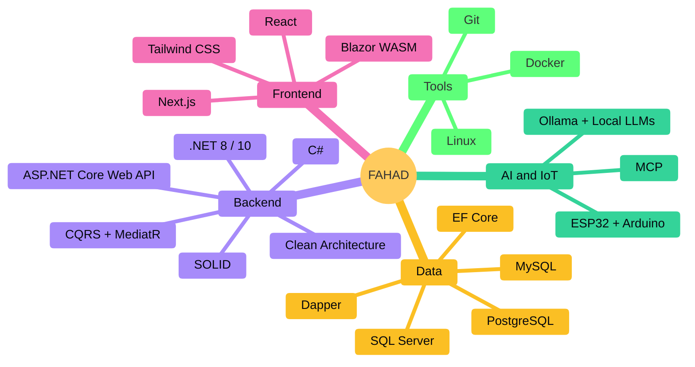
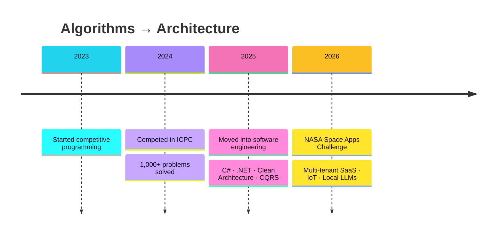

<div align="center">


```text
███████╗ █████╗ ██╗  ██╗ █████╗ ██████╗
██╔════╝██╔══██╗██║  ██║██╔══██╗██╔══██╗
█████╗  ███████║███████║███████║██║  ██║
██╔══╝  ██╔══██║██╔══██║██╔══██║██║  ██║
██║     ██║  ██║██║  ██║██║  ██║██████╔╝
╚═╝     ╚═╝  ╚═╝╚═╝  ╚═╝╚═╝  ╚═╝╚═════╝
      M D .   F A H A D   H A S A N
```

<a href="https://github.com/FahadHasan8386">
  
</a>

*From competitive algorithms to multi-tenant SaaS, IoT pipelines and AI integrations — I build resilient systems engineered for scale.*

<a href="https://linkedin.com/in/fahad-hasan-2969a3282/"></a>
<a href="mailto:hasan.fahad67@outlook.com"></a>
<a href="https://leetcode.com/u/FahadHasan8386/"></a>
<a href="https://codeforces.com/profile/fahadhasan"></a>


</div>

---

## 🎮 PLAYER CARD

```text
┌───────────────────────────────────────────────────────────┐
│ CLASS    Full-Stack .NET Architect                        │
│ GUILD    Algorithms · Architecture · IoT · AI             │
│ CREED    No single stack fits every problem               │
│ QUEST    Build resilient systems engineered for scale     │
│ STATUS   [ONLINE]  open to collaboration & opportunities  │
└───────────────────────────────────────────────────────────┘
```

| Stat | Level | Power | Loadout |
|:--|:--|:--|:--|
| 🧠 **Algorithms** | 🟩🟩🟩🟩🟩🟩🟩🟩🟩🟩 | `19/20` | 1,000+ solved · ICPC 2024 |
| ⚙️ **C# / .NET** | 🟦🟦🟦🟦🟦🟦🟦🟦🟦⬛ | `18/20` | .NET 8 / 10 · ASP.NET Core |
| 🏛️ **Architecture** | 🟪🟪🟪🟪🟪🟪🟪🟪🟪⬛ | `17/20` | Clean · CQRS · SOLID |
| 🗄️ **Databases** | 🟧🟧🟧🟧🟧🟧🟧🟧⬛⬛ | `16/20` | SQL Server · PostgreSQL · MySQL |
| 🎨 **Frontend** | 🟨🟨🟨🟨🟨🟨🟨⬛⬛⬛ | `14/20` | Blazor · React · Next.js |
| 📡 **IoT / Hardware** | 🟥🟥🟥🟥🟥🟥🟥⬛⬛⬛ | `13/20` | ESP32 · Arduino · sensors |
| 🤖 **Local AI** | 🟫🟫🟫🟫🟫🟫🟫⬛⬛⬛ | `13/20` | Ollama · MCP · Llama 3.2 |

<sub>Bars are a fun self-rating, not a formal score.</sub>

---

## 🧰 SKILL TREE

<div align="center">


<br/>


</div>



---

## 🚂 THE TIMELINE



---

## 🔀 HOW MY SYSTEMS FLOW

```mermaid
flowchart LR
  subgraph BF["🏢 BuildFlow · SaaS"]
    A["Blazor WASM"] -->|"JWT + RBAC"| B["ASP.NET Core API"] --> C["Dapper"] --> D[("SQL Server")]
  end
  subgraph AS["🌱 AtmoSync · IoT"]
    S["DHT22 · MQ-7 · MQ-136"] --> E["ESP32"] --> F["ASP.NET Core API"] --> G["Live dashboard"]
  end
  subgraph AI["🤖 Local AI"]
    U["You"] --> H[".NET 10 + MCP server"] --> I["Ollama · Llama 3.2"]
  end
  classDef cyan fill:#0e7490,stroke:#22d3ee,color:#fff,stroke-width:2px
  classDef violet fill:#6d28d9,stroke:#a78bfa,color:#fff,stroke-width:2px
  classDef pink fill:#be185d,stroke:#f472b6,color:#fff,stroke-width:2px
  class A,B,C,D cyan
  class S,E,F,G violet
  class U,H,I pink
  style BF fill:#0b1020,stroke:#22d3ee,stroke-width:2px
  style AS fill:#0b1020,stroke:#a78bfa,stroke-width:2px
  style AI fill:#0b1020,stroke:#f472b6,stroke-width:2px
```



---

## 🛰️ MISSION LOG

> Click a file to open the briefing.

<details>
<summary><b>🔵 MISSION 01 ▸ BuildFlow</b> — Multi-tenant project management SaaS</summary>

<br/>

`ASP.NET Core Web API` `Blazor WASM` `Dapper` `SQL Server` `JWT`

- 🔐 Strict **tenant data isolation** with custom **role-based access control (RBAC)**
- 🔄 JWT **refresh-token** authentication
- 📋 Workspaces, projects, task pipelines, comments and real-time notifications

</details>

<details>
<summary><b>🟣 MISSION 02 ▸ MarsWalk</b> — NASA Space Apps Challenge 2026</summary>

<br/>

`Python FastAPI` `React` `Vite` `NASA DEM datasets`

- 🪐 Martian terrain route-planning and elevation analysis, built with a multidisciplinary team
- 🧭 Pathfinding over NASA elevation data to visualize the **3 safest return routes** for a rover

</details>

<details>
<summary><b>🟢 MISSION 03 ▸ AtmoSync AgroAI</b> — IoT hardware-software pipeline</summary>

<br/>

`ASP.NET Core Web API` `Blazor` `ESP32` `DHT22` `MQ-7` `MQ-136`

- 📡 End-to-end telemetry bridge from gas/climate sensors to a live web dashboard
- 🌾 Real-time sensor ingestion and monitoring for smart-agriculture insights

</details>

<details>
<summary><b>🟠 MISSION 04 ▸ Local LLM Chatbot & MCP File Organizer</b> — privacy-first AI</summary>

<br/>

`.NET 10` `Ollama (Llama 3.2)` `Model Context Protocol`

- 🔒 Conversational assistant powered entirely by local LLMs
- 🗂️ .NET 10 MCP server for directory scanning, smart file categorization and metadata indexing

</details>

<details>
<summary><b>🔴 MISSION 05 ▸ Social Microblogging Platform</b> — CPS Academy</summary>

<br/>

`ASP.NET Core Web API` `React` `Next.js` `PostgreSQL`

- 🌐 Decoupled REST APIs with a modern SSR/SPA frontend
- 🗃️ Relational data modeling in PostgreSQL

</details>

<details>
<summary><b>🟡 MISSION 06 ▸ High-Performance File Streamer & Legacy Data Migrator</b></summary>

<br/>

`C#` `FileStream` `Buffered I/O`

- ✂️ Generates, splits (**5 GB into 100 MB chunks**) and migrates massive datasets
- 🪶 Minimal memory footprint and **zero data corruption**

</details>

---

## 📊 LIVE STATS

<div align="center">


</div>

---

## 📡 OPEN CHANNEL

```text
fahad@dev:~$ ./connect.sh

  linkedin    linkedin.com/in/fahad-hasan-2969a3282
  email       hasan.fahad67@outlook.com
  leetcode    leetcode.com/u/FahadHasan8386
  codeforces  codeforces.com/profile/fahadhasan

  connection established. let's build something great together.
```

<div align="center">


</div>
